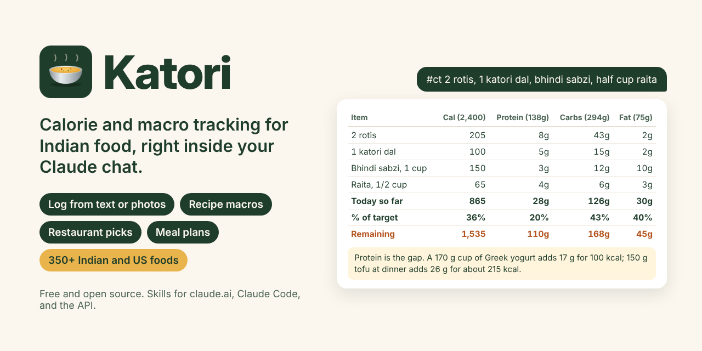

<p align="center">
  
</p>

# Katori: Indian macro tracker for Claude

[](https://github.com/POC4135/calorie-tracker/actions/workflows/ci.yml)
[](https://github.com/POC4135/calorie-tracker/releases/latest)
[](LICENSE)
[](https://agentskills.io)

Katori turns Claude into a calorie and macro tracker that understands Indian food the way it is actually eaten in the US: rotis by the piece, dal by the katori, ghee you cannot see, and takeout portions twice the size of what you serve at home. Type `#ct` and what you ate, or send a photo, and Claude replies with a per-item table, your running totals for the day, what is left, and specific foods that close the gap.

There is no app, no account, and no database. It runs inside your Claude conversation.

## What you get

Four skills that work alone or together:

| Skill | What it does | Try |
|---|---|---|
| **macro-tracker** | Sets daily targets from your age, height, weight, BMR, activity and goal. Logs meals from text, photos or nutrition labels with running totals and suggestions. | `#ct 2 rotis, 1 katori dal, bhindi sabzi` |
| **recipe-macros** | Exact per-serving, per-katori and per-100 g macros for a batch recipe, plus swaps that improve it. | `#ct recipe` and paste the ingredients |
| **menu-macros** | Ranks a restaurant menu against what is left of your day and tells you how to order. | `#ct menu` and a photo of the menu |
| **meal-planner** | One-day or seven-day plans from food you already cook, checked against your targets, with a grocery list. | `#ct plan 7 days, vegetarian, South Indian` |

Under the hood:

- **A food database built for this diet:** 354 foods, including home dishes, Indian groceries, US grocery protein staples, about 40 US Indian restaurant portions, and drinks, with Hindi and regional names (bhindi, vendakkai, pappu, mosaranna) as aliases.
- **A calculator, not mental math:** every total, percentage and plan check comes from a small, tested Python script, because language models slip on long tables.
- **Honest numbers:** each food says where its values come from (USDA, label, documented recipe, or estimate), and estimates say so in the reply.

## Example

You type:

> #ct 2 rotis, 1 katori dal, bhindi sabzi, half cup raita

Claude replies (a vegetarian, 2,400 kcal target, after a poha and chai breakfast):

| Item | Cal (2,400) | Protein (138g) | Carbs (294g) | Fat (75g) |
|---|---|---|---|---|
| 2 rotis | 205 | 8g | 43g | 2g |
| 1 katori dal | 100 | 5g | 15g | 2g |
| Bhindi sabzi, 1 cup | 150 | 3g | 12g | 10g |
| Raita, 1/2 cup | 65 | 4g | 6g | 3g |
| **This meal** | **520** | **20g** | **76g** | **17g** |
| **Today so far** | **865** | **28g** | **126g** | **30g** |
| **% of target** | **36%** | **20%** | **43%** | **40%** |
| **Remaining** | **1,535** | **110g** | **168g** | **45g** |

| | Today | Target |
|---|---|---|
| Fiber | 16g | 34g+ |
| Added sugar | 10g | under 30g |
| Sodium | ~1,610mg | under 2,300mg |

> Protein is the gap: 28 g of 138 g with 1,535 kcal left. A 170 g cup of nonfat Greek yogurt as a snack adds 17 g for 100 kcal. At dinner, 150 g firm tofu or a cup of soya chunks curry adds 17-26 g.
>
> Confidence: medium. Rotis and dal from standard home recipes; assumed 1 tsp extra oil in the bhindi.

More in [docs/examples.md](docs/examples.md): setup, photos, a recipe, a restaurant order, and a full-day plan.

## Install

You need a Claude Pro, Max, Team or Enterprise plan with code execution turned on (Settings > Capabilities > **Code execution and file creation**).

### claude.ai and the Claude desktop app (recommended)

Add this repository as a plugin marketplace, so you get all four skills and future updates:

1. Open **Customize > Plugins** ([claude.ai/customize/plugins](https://claude.ai/customize/plugins)).
2. Select **Add > Add marketplace** and enter `POC4135/calorie-tracker`.
3. Find **Katori** and select **Add**. Turn on **Sync automatically** if you want updates.

### Upload a zip instead

From the [latest release](https://github.com/POC4135/calorie-tracker/releases/latest):

- **All four skills as one plugin:** download [`katori-plugin.zip`](https://github.com/POC4135/calorie-tracker/releases/latest/download/katori-plugin.zip), then **Customize > Plugins > Add > Upload plugin**.
- **One skill:** download [`macro-tracker.zip`](https://github.com/POC4135/calorie-tracker/releases/latest/download/macro-tracker.zip) (or [`recipe-macros.zip`](https://github.com/POC4135/calorie-tracker/releases/latest/download/recipe-macros.zip), [`menu-macros.zip`](https://github.com/POC4135/calorie-tracker/releases/latest/download/menu-macros.zip), [`meal-planner.zip`](https://github.com/POC4135/calorie-tracker/releases/latest/download/meal-planner.zip)), then upload it under **Customize > Skills** and turn it on.

### Claude Code

```text
/plugin install katori --marketplace POC4135/calorie-tracker
```

On versions before 2.1.275, add the marketplace first:

```text
/plugin marketplace add POC4135/calorie-tracker
/plugin install katori@katori
```

### Other agents (Codex, Cursor, OpenCode and others)

The skills follow the open [Agent Skills](https://agentskills.io) format:

```bash
npx skills add POC4135/calorie-tracker
```

The calculator needs Python 3.8 or later on the machine running the agent.

### Claude API

Upload each folder under `skills/` with the Skills API and enable the code execution tool. See [docs/install.md](docs/install.md#claude-api).

Full instructions and troubleshooting: [docs/install.md](docs/install.md).

## First run

Start a new chat and introduce yourself:

```text
#ct setup: 28, male, 5'9", 172 lb, BMR 1720 from my smart scale,
moderately active, goal recomposition, vegetarian
```

Claude checks your BMR against the Mifflin-St Jeor formula, computes your targets, and asks in one message for anything missing:

| Target | Daily |
|---|---|
| Calories | 2,400 kcal |
| Protein | 138g |
| Carbs | 294g |
| Fat | 75g |
| Fiber | 34g+ |
| Added sugar | under 30g |
| Sodium | under 2,300mg |

Then log as you eat. Use one chat per day. To skip setup next time, paste your targets table into a Claude Project's instructions and log inside that project.

## Commands

| Message | What happens |
|---|---|
| `#ct <what you ate>` or `#ct` with a photo | Logs the meal with today's running totals |
| `#ct today` | Today's totals against your targets, plus what to eat next |
| `#ct targets` | Shows your targets again |
| `#ct weight 170 lb`, `#ct goal maintenance`, `#ct activity light` | Recomputes your targets |
| `#ct that was 1 roti not 2`, `#ct remove last`, `#ct reset` | Corrections |
| `#ct export` | Today's log as CSV to paste into a spreadsheet |
| `#ct recipe ...`, `#ct menu ...`, `#ct plan ...` | Recipe macros, restaurant picks, meal plans |
| `#ct what should I eat for dinner?` | Options that fit what is left |

You do not have to type `#ct` for photos or obvious food questions; it just makes logging unambiguous.

## How the numbers work

- **Targets:** BMR from your number when it is within 10% of Mifflin-St Jeor (or lab-measured), otherwise the formula. TDEE = BMR x activity factor (1.2 to 1.725). Calories = TDEE x goal factor (0.80 fat loss, 0.90 recomposition, 1.00 maintenance, 1.10 lean gain), never below BMR. Protein 1.6-1.8 g/kg (the ISSN range for people who exercise is 1.4-2.0; the 2025-2030 US Dietary Guidelines suggest 1.2-1.6), sized from the weight at BMI 25 if you are above it. Fat 28% of calories. Carbs are the remainder, so the macros always add up. Fiber 14 g per 1,000 kcal (National Academies). Added sugar under 5% of calories, a ceiling rather than an allowance: the WHO's stricter limit, while the 2025-2030 US Dietary Guidelines recommend none. Sodium under 2,300 mg (US Dietary Guidelines). BMI is shown with the WHO action points for Asian adults (23 and 27.5).
- **Foods:** raw ingredients come from USDA FoodData Central; packaged foods from typical US labels; seven everyday dishes are computed from documented recipes in [`data/recipes/`](data/recipes); the rest are estimates from standard recipes and portions, marked as such.
- **Checks:** 750+ automated tests confirm every food's calories match its macros, every recipe-based food reproduces from its recipe, and the calculator's math and safety rules hold.

Details and sources: [docs/methodology.md](docs/methodology.md).

## Accuracy and limits

- **Estimates, not lab measurements.** Even US nutrition labels may legally run up to 20% above their stated calories. Typed meals with clear portions are usually close; photos and restaurant meals can be off by 20-30% or more, mostly from oil, ghee and cream you cannot see. Weighing food or giving label values closes most of that gap.
- **One chat holds one day.** Katori stores nothing, so there is no history across chats. Use `#ct export` if you want a record.
- **Formulas are starting points.** Two to three weeks of consistent logging and your weight trend tell you more than any BMR estimate.
- **Not medical advice.** See [DISCLAIMER.md](DISCLAIMER.md).

## Privacy

Katori has no servers and makes no network calls. The calculator runs in Claude's code sandbox and reads only the files that ship with the skills. Your messages and photos are handled by Claude under your account's privacy settings, like any other chat. Details: [PRIVACY.md](PRIVACY.md).

## Safety

Katori sets no targets for anyone under 18, never plans below BMR, 1,200 kcal (women) or 1,500 kcal (men), defers to a clinician for diabetes, kidney disease, pregnancy and appetite-affecting medication, and stops giving numbers if a conversation shows signs of disordered eating. In the US, the National Alliance for Eating Disorders helpline is 1-866-662-1235.

## Contributing

Missing your family's dish, or a value that looks wrong? Open a [food request](https://github.com/POC4135/calorie-tracker/issues/new?template=food_request.yml) or a pull request. [CONTRIBUTING.md](CONTRIBUTING.md) explains how the data, tests and build work.

## License

[MIT](LICENSE). Katori is an independent project and is not affiliated with or endorsed by Anthropic.
